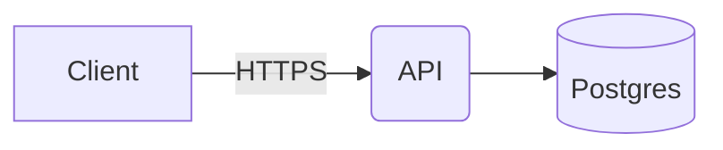

# OpenFlowKit diagrams

Write Mermaid or OpenFlow DSL, hand it to the `openflowkit` MCP server, and save the result as a
`.openflow.json` beside the code it explains: it opens at app.openflowkit.com (Open file) and reads back.

**When to draw:** a flow with branches, a system with more than three moving parts, a protocol,
a data model, a state machine. Not a list, a single call, or what one sentence explains.

## Setup (once)

`claude mcp add -s user openflowkit -- npx -y openflowkit mcp` (any MCP client: `npx -y openflowkit mcp`); it
calls no outside service. In claude.ai or ChatGPT, `https://mcp.openflowkit.com/mcp` draws chat cards only.

## Draw and save

1. Write the diagram in Mermaid (what you already know) or OpenFlow DSL (below).
2. `validate_openflow_dsl` with `{ dsl }` until `ok`. Fix every `error`: a line the parser dropped is one,
   with its line and a hint. Warnings are guesses; read them. For Mermaid (or Structurizr DSL, D2),
   `converted.losses` name what did not carry over and `converted.dsl` is what it became.
3. With an editor paired (`whoami`; if not, ask the user to open app.openflowkit.com/#/connect),
   `create_diagram` with `{ dsl }` draws where the user is looking. Otherwise use file mode:
   `openflow_create`, then `create_diagram` with `{ dsl, documentId }`.
4. `openflow_save` with `{ path }` (plus `documentId` in file mode) beside the code, e.g.
   `src/payments/checkout-flow.openflow.json`; `svg: true` also writes a `.svg` (for a README).
5. Tell the user the path, and what you left out.

## Change a diagram

`get_diagram` returns the DSL and `frameId` (file mode: `openflow_open` first, then pass
`documentId`) → edit the text → `update_diagram` with `{ frameId, dsl }` → `openflow_save`.
Not `create_diagram` again: that draws a second diagram. `update_diagram` redraws from the text, so
`canvasEdits` (the user's recolours, moves, renames) are lost unless you merge each `carry` into that
node's one `[ … ]` list; `discarded` lists any lost. "The box I selected" is `selection` in `get_document`.

## Draw this repo's architecture

`discover_architecture` with `{ path }` proposes a C4 workspace (`dsl`) from the code. Review its
names, `create_diagram` with it, and write the text to `architecture.ofk` at the repo root; later,
`drift_report` with `{ path }` says what the code gained or lost since.

## OpenFlow DSL in one screen

First line is the family: `flowchart`, `architecture`, `sequence`, `state`, `erd`, `class`,
`mindmap`, `gitgraph`, optionally with a direction (`flowchart right`). Lines are statements;
`//` starts a comment. Nodes are declared by name; edges declare their ends.

```dsl
flowchart right
title: Checkout
group Payments {
  Pay [diamond]
  Stripe [icon: tabler/brand-stripe]
}
Cart -> Pay : card ok?
Pay -> Done [ellipse, green] : yes
Pay --> Cart : no [red]
Pay -> Stripe : charge [thick]
```

- Arrows: `->` solid, `-->` dashed, `<->` both ends, `--` no heads, `A -> B : label`.
- Attributes go in `[ … ]`: a shape, a colour, a fill, flags, or `key: value`.
- Shapes: `rect rounded circle ellipse diamond cylinder hexagon cloud doc note parallelogram person queue component browser mobile`
- Colours: `blue green red orange violet teal pink yellow gray` or `#hex`.
- Icons: `icon: aws/lambda`, `gcp/pubsub`, `tech/react`, `tabler/user`. A node whose label names a
  technology (`Postgres`, `Redis`, `S3 bucket`) gets its icon by itself; `icon: none` stops it.
  `iconpos: left` draws an icon card as a row, the icon beside its name. `search_icons` finds exact ids.
- `group Name { … }` boxes the nodes first mentioned inside it, so open groups before edges.
  An edge to `Name` ends on the group itself.
  `note Name : text` pins a sticky to a node.

```dsl
sequence
participant Browser [person]
Browser -> API : POST /login
API -> DB : find user
DB --> API : row
alt valid {
  API --> Browser : 200 + token
} else invalid {
  API --> Browser : 401
}
```

```dsl
erd
users {
  id uuid pk
  email text unique
}
orders {
  id uuid pk
  user_id uuid fk
}
users ||--o{ orders : places
```

For any other family, or more detail, call `get_syntax` with the family name.

## Mermaid works too



Converts: flowchart, sequenceDiagram, stateDiagram, classDiagram, erDiagram, mindmap, architecture-beta,
gitGraph; not gantt, pie, journey (write `chart bar` DSL, see `get_syntax`). Structurizr and D2 text convert too.

## Rules

- One diagram per idea; split before forty nodes. Name nodes as the code does (`OrderService`).
- Do not place coordinates; layout is computed. Change the text and `update_diagram`.
- Check before you claim: `validate_openflow_dsl` passes, then save, then report the path.
